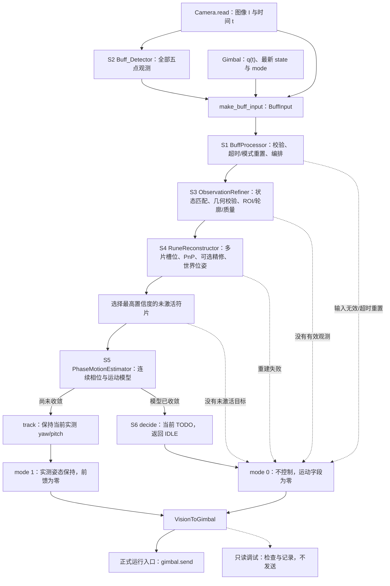

# auto_buff 打符链路流程设计（图像采集 → 云台指令下发）

> 更新日期：2026-11-04
> 性质：打符链路的分模块设计与实现指引，规定各模块的职责边界、输入/输出数据结构、处理流程与调用次序。本文作为本次重构依据；流程编排参考深大 RP-26Rune，后续只借鉴算法，不引入其框架依赖。
> 当前范围：继续使用真实相机录像与同步串口姿态验证 S3/S4，并接入 S5 大符运动估计。已增加逐片距离场、受门限约束的装甲 Chamfer、显式上一帧位姿先验和运动诊断；S6 弹道/开火算法仍未实现。本轮使用的实车观测调试入口仅接收串口。第 8 节是历史编译记录，第 10 节记录本轮真实数据验证。
> 已测试功能、问题清单和当前实际数据流的集中说明见第 11 节。这里的“同步”指图像与姿态文件对应、按图像时间查询四元数，不代表曝光与电控硬件时钟已经同步验收。

---

## 1. 总体流程与数据接口

整链路按职责分为 S1 编排与 S2～S6 处理阶段。S2 由调用方执行，再通过统一输入适配器进入 S1；`BuffProcessor` 持有并调用 S3～S6：

```
图像帧/平台状态
  → S2 检测(Buff_Detector / YOLO11_BUFF)
  → make_buff_input(本帧全部检测 + 图像/时间/平台状态)
  → S1 编排入口(BuffProcessor::process)
      → S3 观测精化(ObservationRefiner)
      → S4 3D 重建与位姿估计(RuneReconstructor / rune_pose_tools)
      → S5 相位与运动估计(PhaseMotionEstimator)
      → S6 决策与弹道(BuffDecisionModule)
  → VisionToGimbal → 串口 → 电控
```

模块间以结构化数据交接，领域数据定义于 `rune_types.hpp`、`buff_processor.hpp`、`buff_decision_module.hpp`，通信结构定义于 `io/gimbal/gimbal.hpp`：

```
cv::Mat
  → std::vector<BuffObservation>
  → BuffInput.observations
  → std::vector<RefinedObservation>
  → std::optional<RuneReconstruction>
  → std::optional<RuneTarget>
  → BuffDecision
  → io::VisionToGimbal
```

即：模块通过明确的输入/输出传递数据，无跨模块共享可变状态。`FrameTimestamp` 统一为 `std::chrono::steady_clock::time_point`。

- `BuffInput` 保存当前图像、整帧 `std::vector<BuffObservation>`、时间戳、IMU 四元数与电控状态，不再把检测集合压缩为单片五点数据。
- `RunePose` 保存世界坐标圆心、符姿态、盘面法向、相位零方向及扇叶半径。局部 +X 对应盘面法向，局部 +Z 对应相位零方向；正相位按法向右手定则定义。
- `RuneSlot::ONE`～`FIVE` 表示物理槽位，不能使用检测排序作为身份。`RuneReconstruction` 同时携带 `pose` 与 `std::vector<ReconstructedBlade>`；每片包含原始精化观测、槽位和世界坐标装甲中心，供 S5 完成相位投影与切片补偿。
- `RuneTarget` 使用具体的 `RunePose`、`MotionState`、`RuneSlot` 字段；成功的 `optional<RuneTarget>` 表示有效观测、几何和已收敛运动模型，阶段失败返回空值，不构造缺失几何或运动的半成品目标。
- `MotionState` 包含瞬时相位/角速度、方向、参考时间、模型类型与收敛状态；大符谐波模型另存模型历元 `model_epoch` 和 `A/B/b/C/ω` 五个系数，以便 S6 按原模型外推。

---

## 2. 模块实现状态

| 模块 | 文件 | 状态 |
|---|---|---|
| S2 检测 | `tasks/auto_buff/buff_detector.cpp`、`yolo11_buff.cpp` | ✅ 已实现 |
| S3 观测精化 | `tasks/auto_buff/observation_refiner.cpp/.hpp` | ✅ 已实现 |
| S1 编排 | `tasks/auto_buff/buff_processor.cpp/.hpp` | 改为整帧输入与 S3～S6 分级编排、状态重置和输出映射 |
| 共享数据结构 | `tasks/auto_buff/rune_types.hpp` | 补充槽位、相位基准、重建结果与可外推运动模型 |
| S4 3D 重建与位姿 | `tasks/auto_buff/rune_reconstructor.hpp/.cpp` | 基础多片 PnP、显式上帧位姿初始化及盘面突跳拒绝；至少两片有效观测；轮廓精修不通过时保留 PNP |
| S4 位姿工具 | `tasks/auto_buff/rune_pose_tools.hpp/.cpp` | PnP、逐片距离场与受约束装甲 Chamfer 已实现；绝对轮廓误差不合格不得标记精修成功 |
| S5 运动估计 | `tasks/auto_buff/phase_motion_estimator.hpp/.cpp` | 已实现世界相位基、解缠/换片补偿、小符方向投票与 Kalman、大符频率搜索/LM/IRLS；仅收敛输出目标 |
| S6 决策与弹道 | `tasks/auto_buff/buff_decision_module.hpp/.cpp` | 已建立领域决策和姿态保持接口；弹道/开火算法 TODO，`decide()` 返回空闲 |
| 构建 | `tasks/auto_buff/CMakeLists.txt` | 已注册算法源文件；本轮重新编译观测调试、实车 Buff 入口和 standard_mpc 均通过；历史记录见第 8 节 |

---

## 3. 模块详细设计

### S2 检测 `Buff_Detector`（已实现）

- 职责：由 BGR 图像生成一帧内所有扇叶的标准五点观测。
- 输入：`cv::Mat & bgr_img`。
- 处理：`YOLO11_BUFF::get_multicandidateboxes` 完成 OpenVINO 推理与后处理（letterbox → 推理 → anchor 解码 → NMS）；逐目标调用 `to_observation`，将模型关键点序 `[top,left,R,right,bottom]` 重排为公开序 `[top,right,bottom,left,R]`。
- 输出：`std::vector<BuffObservation>`（NMS 已按 `quality = conf × mean(kpt_conf)` 降序，首元素为最高置信观测）
  - `BuffObservation::points`（`BuffPoints`）：五点像素坐标
  - `BuffObservation::activation`（`BuffActivation`）：INACTIVE / SMALL_ACTIVATED / BIG_ACTIVATED
  - `BuffObservation::confidence`：检测置信度

### S3 观测精化 `ObservationRefiner`（已实现）

- 职责：以网络五点观测为先验，对每一片扇叶做传统视觉精化——语义差分提取轮廓、三类互斥语义分类（装甲板 / R标 / 灯臂）、几何校验与质量分级。产出可供 S4 位姿对齐使用的轮廓特征。
- 输入：
  - `const cv::Mat & image`：原始 BGR 图像
  - `const BuffObservation & observation`：S2 输出单片观测
  - `const RuneState & state`：大小符状态（由电控档位与激活类别解析）
- 处理（`refine()`）：
  1. `validate_observation`：图像格式、置信度、五点有限性与界内、几何退化（凸性/最短边/面积/R 标与角点不重合）逐项校验；不合格返回 `INVALID` 并附 `ObservationRejectReason`。
  2. `make_roi`：由五点外接矩形按比例外扩生成 ROI。
  3. `make_binary_mask`：通道差 `absdiff(B,R)` → 高斯滤波 → 阈值二值 → 闭运算（形态学）。
  4. `extract_semantic_contours`：findContours 后按包含/排斥约束分类：含装甲中心且面积误差最小者为装甲板；含 R 点且不含其余语义点为 R 标（取面积最小）；不含两类点且"装甲中心—R"连线穿过者为灯臂（取面积最大）。每类计算实心度等 `support`。
  5. 质量判定：三类轮廓齐备、置信度与几何分达阈值 → `GOOD`，否则 `DEGRADED`。
- 输出：`RefinedObservation`
  - `state`、`points`、`detection_confidence`
  - `roi`（`cv::Rect`）、`armor_polygon`
  - `armor_contour` / `r_mark_contour` / `light_arm_contour`（`ContourFeature`：全图坐标轮廓 + `support` + `usable()`）
  - `quality`（`TrackingQuality`）、`geometry_score`

多片场景：对观测集合循环调用 `refine`，剔除 `quality == INVALID` 的片。

### S4 3D 重建与位姿估计 `RuneReconstructor` + `rune_pose_tools`（新增）

`reconstruct(blades, imu_q, previous_pose = nullopt) → std::optional<RuneReconstruction>` 已实现基础多片 PnP，构造时读取相机标定。以参考片的 PnP 为种子，将其他片反投影至模型盘面后匹配 72° 槽位，再联合五点观测求解。使用遗留模型的 0.7 m 旋转半径、0.127 m 装甲半对角；至少需要两片有效且不同槽位的观测。通过正深度和重投影误差检查后输出 `PoseSource::PNP`，盘面方向由刚性模型姿态给出。现在可用上一帧世界位姿经当前 IMU/外参逆变后初始化 LM 分支；该分支的锚点 RMS 不能超过独立最优解 +0.5 px。先验存在时，盘面法向突跳超过 20° 的观测被拒绝，由调用方在 200 ms 失效后重新捕获。已知装甲菱形边界按每片轮廓独立建立距离场并精修；必须改善距离残差、平均轮廓误差 ≤3 px、RMS ≤5 px、重投影误差不超过 PnP +1 px/15 px，并满足正深度与位姿改变量约束，才标记 `CHAMFER_REFINED`。实际边界不匹配或证据缺失时保留 `PNP`。轮廓锚框、灯臂/R 实体边界模型及独立 SVD 平面拟合仍未实现，以下列出完整 S4 的设计目标。

- 职责：将多片 2D 精化观测组合为能量机关的 3D 几何——圆心、盘面法向与整体位姿。单一片无法确定圆心，必须以多片联合求解；对标深大 `PowerRunePlane`/`Projector`。
- 输入：
  - `const std::vector<RefinedObservation> & blades`：S3 有效片集合
  - `const Eigen::Quaterniond & imu_q`：机体姿态（用于 gimbal→world 坐标变换）
  - 相机内参与相机—云台外参（构造时由配置读取）
- 处理（`reconstruct()`）：
  1. 号位匹配：按各片相对圆心的极角，将扇叶分配到 1~5 号位（槽位间隔 72°=2π/5），以未激活片为 1 号位基准。
  2. 圆心像素初值：对多片 `r_mark_contour` 做 `cv::fitEllipse` 取圆心。
  3. 锚点聚合：取未激活片的装甲板/灯臂轮廓 PCA 定向外接矩形角点作为锚点。
  4. 先验位姿：锚点 2D 与对应 3D 模型锚框点做多锚点 `solvePnP`（`PoseSource::PNP`）。
  5. 位姿精修：调用 `rune_pose_tools` 执行 Chamfer 距离场 + Ceres 优化；成功置 `PoseSource::CHAMFER_REFINED`，失败回退 PnP 结果并标记该帧可信度受限。
  6. 平面估计：对重建点云去中心化 SVD 拟合盘面，最小奇异值方向为法向并按朝向约束翻转。
- 输出：`std::optional<RuneReconstruction>`
  - `pose.position_world_m`（`Eigen::Vector3d`）：圆心世界坐标
  - `pose.orientation_world`（`Eigen::Quaterniond`）：符整体姿态
  - `pose.plane_normal_world`、`pose.phase_zero_direction_world`：相互垂直的单位方向，确定盘面与相位基准
  - `pose.blade_radius_m`：圆心至装甲中心半径，模型默认 0.7 m
  - `pose.reprojection_error_px`：位姿重投影误差，供决策层判断可信度
  - `pose.confidence`、`pose.source`（`PoseSource`：PNP / CHAMFER_REFINED）
  - `blades`：每片的 `observation`、`RuneSlot slot`、`armor_center_world_m`，S5 不依赖隐含相机上下文推导世界坐标
  - 空 optional：本帧无法重建，链路输出 mode 0。

`rune_pose_tools`（无状态工具函数）：
- `solve_pnp_multi_anchor(anchors_2d, anchors_3d, camera_matrix, distortion_coeffs, initial_prior = nullopt) → std::optional<CameraPose>`：模型到相机的 `rvec/tvec`，平移单位米。
- `make_distance_transform(contours, roi) → std::optional<DistanceField>`：轮廓边界的欧氏距离场，包含 ROI 与像素距离矩阵，避免混淆全图/局部坐标。
- `refine_by_chamfer(model_points, distance_field, calibration, prior_pose, plane_y_constraint_weight) → std::optional<ChamferRefinement>`：优化后位姿、优化前后轮廓距离与采样数。多片使用各自距离场，`plane_y_constraint_weight` 当前只接受 0，尚未擅自引入无坐标定义的平面约束。

### S5 相位与运动估计 `PhaseMotionEstimator`（新增）

当前提供 `update(pose, target_blade, timestamp)`、`reset()` 与只读 `diagnostics()`。S4 的相位零方向随帧内参考片转动，S5 因而独立选取世界方向并投影到当前盘面，输出带稳定相位基的 `RuneTarget.pose`。换片时按 72° 平移整个历史窗口、滤波相位与谐波常数项，同时记录累计偏移，便于预测留出验证；不依靠帧内 slot 编号断言跨帧物理身份。以下流程已实现，只有满足数据跨度、方向、残差与速度门限的模型才输出目标。

- 职责：由靶心观测与 3D 几何维护连续相位与运动模型，为命中时刻外推提供依据；对标深大 `PhaseMotionEstimator`。
- 输入：
  - `const RunePose & pose`：S4 输出的符几何
  - `const ReconstructedBlade & target_blade`：当前目标片观测、物理槽位和世界坐标装甲中心
  - `FrameTimestamp timestamp`：帧时间
- 处理（按大小符分流）：
  1. 将靶心投影至盘面、绕法向求观测相位。
  2. 相位连续化：跨帧解缠；检测 target 切换，按 `k·2π/5` 平移整窗历史相位，避免切换被误判为转速突变。
  3. 小符：旋转方向投票 + 一维相位卡尔曼（角速度初始化 ±π/3）。
  4. 大符：LM-IRLS 拟合相位方程 `θ(t) = A·cos(ωt) + B·sin(ωt) + b·t + C`（外层 LM 迭代 ω，内层 IRLS 加权最小二乘），预测直接由方程外推。
- 输出：`std::optional<RuneTarget>`
  - `RefinedObservation observation`：当前观测
  - `RunePose pose`：S4 结果
  - `RuneSlot slot`：物理槽位，与检测置信排序无关
  - `MotionState motion`：`continuous_phase_rad`、`angular_velocity_rad_s`、`direction`（RotationDirection）、`reference_timestamp`、`model`、`model_epoch`、`harmonic_phase`、`confidence`、`converged`
  - `harmonic_phase`：`cos_amplitude_rad`（A）、`sin_amplitude_rad`（B）、`linear_rate_rad_s`（b）、`phase_offset_rad`（C）、`angular_frequency_rad_s`（ω）；方程时间为距 `model_epoch` 的秒数
  - `TrackingQuality quality`
  - 空 optional：已有有效重建但运动未收敛时，通过 S6 `track(gimbal)` 保持当前有限的实测 yaw/pitch、前馈置零、禁止开火（mode 1）；若姿态无效则 mode 0。这一占位行为只保持姿态，不代表已经实现目标跟随。

### S6 决策与弹道 `BuffDecisionModule`（新增）

当前提供 `decide(target, gimbal, now) → BuffDecision`、`track(gimbal) → BuffDecision` 与 `reset()`；`decide()` 保留 TODO 并输出 IDLE，`track()` 仅实现上述姿态保持，不产生零角度的虚假瞄准指令。以下为后续算法设计。

- 职责：由运动模型外推命中时刻，联合弹道解算云台角，并经决策状态机输出开火许可；对标深大 `RuneDecisionModule`。
- 输入：
  - `const RuneTarget & target`：S5 输出
  - `const io::GimbalState & gimbal`：含 `bullet_speed`、云台姿态
  - `std::chrono::steady_clock::time_point now`
- 处理：
  1. **命中点外推**：命中点无法预先固定（扇叶旋转 + 子弹飞行时间非零），按固定点迭代求命中相位：
     - 以初始飞行时间估计 t₀ → 由 `MotionState` 外推 `phase(now + t)`；
     - 由相位求命中靶心 3D：`armor_center_at(圆心, 起始方向, 盘面法向, 半径, phase)`（起始方向绕法向旋转 phase、乘以半径 0.7 m 后叠加圆心）；
     - 以靶心解算弹道得新飞行时间，迭代至收敛（判据如 `|Δt| < 0.01 s`）。
  2. **弹道解算**：输入靶心水平距离 d、高度 h 与弹速 v0，输出 pitch 与飞行时间。先沿用现有无阻力模型 `tools/trajectory.cpp`；后续可升级为含空气阻力 + 马格努斯项的 RK4 与 Ceres 联合拦截。
  3. **决策状态机**：目标切换防抖（大符需连续多帧确认）、开火冷却计时、数据超时平滑回圆心（`recover2rune_center`）、开火许可判定。
- 输出：`BuffDecision` 领域决策，由 S1 映射为 `VisionToGimbal` 字段；S6 不依赖串口协议布局
  - `mode`：`BuffControlMode::IDLE` / `TRACKING` / `FIRE`，对应空闲 / 跟踪禁开火 / 可开火
  - `yaw`、`pitch`：云台期望角
  - `yaw_vel`、`yaw_acc`、`pitch_vel`、`pitch_acc`：速度/加速度前馈
  - 六个运动字段在领域结构中使用 `double`，默认值均为零，默认 mode 为 IDLE

### S1 编排 `BuffProcessor::process`（结构重构）

- 职责：统一处理入口，接收外部 S2 的整帧观测，按 S3→S4→S5→S6 顺序编排；不在内部重新检测图像。
- 每片观测先结合电控大小符模式解析 `RuneState`，剔除冲突或 S3 无效观测；有效集合整体送入 S4，之后从重建片中选择未激活目标，保留其物理槽位与三维装甲中心。
- 输入无效、无有效观测、无有效重建或无可用目标时输出 mode 0；有效重建后 S5 未收敛时保持实测姿态 mode 1；只有未来完整的 S6 决策才可发出 mode 2。
- 处理补充：mode 0 时清零全部运动字段；模式切换 / 时间倒退 / 超过 `tracking_timeout_ms` 时级联重置内部状态；最终把领域决策封装为 `io::VisionToGimbal`。
- 重建成功时间独立记录，连续检测但几何失败不能延长已有几何的有效期。运行入口在离开打符等档位切换时主动调用 `reset()`，确保短暂切走后回到同一档位也清除历史。
- 输出：`io::VisionToGimbal`（28 字节：2 字节 SP 头 + 1 字节 mode + 6 个 `float` 运动字段 + 1 字节 `0xef` 尾）→ `gimbal.send()`；通信 ABI 保持现有定义。
- 基础 S4 成功而 S5 未收敛时，生产入口保持当前实测姿态 mode 1；S5 收敛后进入尚未实现的 S6 `decide()`，当前返回 mode 0，不能视为已经跟随目标。S4 的 PnP 结果不允许开火。第 9 节入口默认只运行 S2/S3/S4，S5 与 S1 只读检查分别通过显式选项开启，始终不发送云台指令。

---

## 4. 与遗留代码的关系

`buff_solver`、`buff_target`、`buff_aimer`、`buff_predict` 和 `buff_type` 的旧接口与实现已删除，检测器也已移除遗留 `FanBlade` 适配器。旧 `buff_target` 专用的 `tools/ransac_sine_fitter` 及各机器人配置中的旧 `buff_aimer` 参数一并清理。主程序经 `Buff_Detector → BuffProcessor` 执行，直接传递标准五点观测；以下表格保留历史替换关系：

| 环节 | 遗留实现 | 本设计 |
|---|---|---|
| 3D 位姿 | `buff_solver`：单扇叶 5 点 PnP | PnP 保留为先验 + Chamfer 精修（多片联合），S4 |
| 大符运动预测 | `buff_target`：10 维 EKF + RANSAC | LM-IRLS 相位方程拟合 + 外推，S5 |
| 小符运动预测 | 7 维 EKF | 一维相位卡尔曼 + 方向投票，S5 |
| 开火决策 | 旧 `aimer`：角度阈值 + mistake_count | 独立决策状态机（冷却/防抖/回圆心），S6 |
| 弹道 | `tools/trajectory.cpp`（无阻力两轮迭代） | 先复用；后续升级含阻力 RK4 + Ceres 联合拦截 |

大符弃用 EKF+RANSAC 的原因：角速度作状态导致噪声两次放大；RANSAC 拟合结果未接入预测；target 切换易被误判为高速跳变。

---

## 5. 接口重构阶段的落地范围（2026-11-04）

本次重构以本文的数据流和职责边界为准：统一多片输入、物理槽位、世界坐标几何和运动模型表达；建立 S4/S5/S6 接口；接入 S1 分级编排、失败降级和状态重置；注册构建源文件。S2/S3 已有算法继续使用。

该阶段尚未实现 S4 的槽位匹配/PnP/Chamfer/SVD、S5 的运动估计、S6 的命中迭代/弹道/开火状态机。后续基础 PnP 的测试入口见第 9 节。不得以默认位姿、默认槽位或默认运动状态替代成功结果，也不得为接通接口而生成开火帧。

接口重构阶段仅做编译验证，结果见第 8 节；当时未新增实车、仿真数据或算法精度测试，现有测试程序仅适配新输入接口和占位降级语义，未执行。

---

## 6. 深大 RP-26Rune 借鉴点

**移植保留**：R 标轮廓拟合圆心；多片锚点 PnP + Chamfer 精修并可回退；大符 LM-IRLS 相位方程拟合；target 切换的 `k·2π/5` 整窗相位补偿；小符方向投票与一维相位卡尔曼；决策状态机（冷却/切换防抖/超时回圆心）；mode 0/1/2 输出语义。

**不引入**：TFTree / Foxglove / glog 等框架依赖；插件式架构；`compensate_pitch`（对方弃用的死代码）；多帧平面滑窗（对方实测退化）。

---

## 7. 实现与验收顺序

接口重构的编译记录见第 8 节；当前已进入观测与基础 PnP 联调，入口见第 9 节。

后续算法阶段保留以下设计顺序，具体测试范围届时另行确定：

1. S4：实现号位匹配、圆心拟合、多锚点 PnP 先验与 SVD 平面估计，再接入 Chamfer 精修。
2. S5：实现相位解缠、target 切换补偿、小符一维卡尔曼与大符 LM-IRLS 拟合。
3. S6：实现命中点外推—弹道迭代与决策状态机，覆盖冷却/防抖/回圆心。
4. 算法与数据具备后再执行精度验收，例如位姿重投影误差 median ≤ 3 px、P95 ≤ 6 px、大符 0.5 s 相位预测误差等；这些是未来验收设想，尚未验证。

---

## 8. 接口重构阶段编译验证（2026-11-04）

```bash
cmake --build build --target \
  auto_buff auto_buff_debug auto_buff_debug_mpc auto_buff_test \
  buff_processor_protocol_test \
  buff_detector_test buff_refiner_video_test \
  standard_mpc uav standard auto_aim_test gimbal_test -j4
```

结果：上述保留的 12 个目标在该阶段均编译通过，命令退出码为 0；原记录中的第 13 个目标 `buff_detector_adapter_test` 随旧接口一并删除。当前环境为 ROS2 Jazzy，项目按现有逻辑跳过 Humble 专用目标。该阶段未执行测试程序、视频回放、实车或仿真运行；编译通过仅确认接口、依赖和链接兼容，不代表后续算法已完成或精度已验收。

---

## 9. 实车观测与基础 PnP 调试

`auto_buff_observation_debug` 直接运行 S2 → S3 → S4。串口只接收 IMU 和模式，不调用 `gimbal.send()`，不经过运动预测、弹道或开火决策。检测器会在输入上绘制标注，因此工具只把图像副本交给检测器，轮廓提取和原始录制均使用干净原图。

从仓库根目录运行，带值参数使用 `=`。以下命令显式使用 OpenVINO/CPU，可用于默认关闭 TensorRT 的构建；当前 `standard4.yaml` 的实车配置显式选择 TensorRT FP32，直接沿用该配置运行时需按第 12 节启用 TensorRT 并生成 engine：

```bash
cmake -S . -B build
cmake --build build --target auto_buff_observation_debug -j4

# 实车：默认跟随电控大小符档位；浏览器打开 http://127.0.0.1:8080
./build/auto_buff_observation_debug --config=configs/standard4.yaml \
  --backend=openvino --device=CPU --record

# 有界采集，不开启网页或本地窗口
./build/auto_buff_observation_debug --config=configs/standard4.yaml \
  --backend=openvino --device=CPU --headless --frames=100

# 电控暂未切打符档时，可明确指定本次观测的大小符模式；姿态仍来自串口
./build/auto_buff_observation_debug --config=configs/standard4.yaml \
  --backend=openvino --device=CPU --mode=small

# 回放实际采集的录像与原始时间/姿态，不连接相机或串口
./build/auto_buff_observation_debug --video=records/2026-11-04_19-53-49.avi \
  --imu=records/2026-11-04_19-53-49.txt --mode=big \
  --backend=openvino --device=CPU --motion --headless --frames=300
```

本机远程访问时，将 `127.0.0.1` 换为视觉主机 IP。默认读取配置中的网页端口和推流参数；需要本地窗口时使用 `--window=true`。`--record` 使用现有 Recorder 保存 `records/*.avi` 和同名 `*.txt`（每行 `t qw qx qy qz`）。每次运行另存独立 JSONL 诊断日志，也可用 `--log=路径` 指定位置。录像回放加 `--imu=records/同名.txt` 即可使用原始时间和姿态；不提供时明确显示单位姿态，该结果只能检查图像几何，不能用于实车世界坐标稳定性验收。

建议按顺序检查：

1. **采集和姿态**：确认图像连续、四元数有限且范数接近 1；电控反馈模式与工具使用模式符合预期。`mode=serial` 下空闲/自瞄档仅显示候选图像诊断，不向 S4 传递有效符观测。配置中的内参、畸变和手眼外参必须对应当前镜头、图像分辨率与相机安装，`t_camera2gimbal` 单位为米。
2. **S2/S3**：确认五点顺序 `[上,右,下,左,R]`，ROI 包含完整轮廓；装甲板为绿、R 标为紫、灯臂为青。查看质量、几何分数和拒绝原因。轮廓缺失会降为 `DEGRADED`，仍可参与基础 PnP；当前 S3 并不修正网络五点坐标。网络检测正常但轮廓消失时，检查曝光是否令灯条发白（R≈B），再调整曝光和 `observation_refiner.binary_threshold`。
3. **S4**：同帧至少两片有效、槽位互异的扇叶才进行联合重建。重投影角点应贴合原始观测，检查 R 圆心、槽位和法向是否连续，记录 `reprojection_error_px` 和距离随帧变化。15 px 是当前拒绝门限，不是精度验收标准；低误差也不能替代实际测距。槽位以本帧参考片为基准，当前没有跨帧物理身份跟踪。
4. **世界坐标**：保持车辆位置和符盘位置不变，缓慢转动云台，检查世界圆心是否稳定。当前变换仅使用姿态和固定手眼外参，不含车辆平移里程计；时间戳也尚非硬件曝光同步，快速转动下的偏差需要单独排查。

当前限制：独立 SVD 平面拟合、灯臂/R 实体边界精修和 S6 尚未实现。仅装甲边界支持受门限约束的 Chamfer；S5 未收敛时仍不输出目标。现有 `Gimbal` 构造函数和 `q(timestamp)` 会等待串口数据，断流时可能阻塞；有界帧数不能保证串口故障时及时退出。生产 `BuffProcessor` 的超时由 20 ms 调整到 200 ms，以匹配实测约 40 ms 的帧间隔及 S5 的 0.20 s 有效观测间隔。本入口自身的几何先验也在 200 ms 后失效。

### 真实设备采集记录（2026-11-04）

使用 `configs/standard4.yaml`，已从海康 MV-CS016-10UC 与 `/dev/ttyUSB0 @ 115200` 完成 60 帧真实采集，分辨率为 1440×1080，四元数范数约为 1，平均检测处理耗时 16.4 ms，帧时间间隔中位数 13.4 ms。日志为 `records/buff_live_smoke_20261104.jsonl`，原始图像与姿态为 `records/2026-11-04_19-49-42.avi/.txt`。

此次录像首帧像素范围仅 0～1/255，画面几乎全黑；电控模式为 `IDLE`，60 帧均未检出符片，因此这里只确认采集与姿态链路连通，没有完成真实符观测或重建精度验收。后续改为持续真实相机录制，诊断日志使用 `records/buff_real_camera_20261104.jsonl`；需要检查镜头盖、光圈和目标照明，并将电控切到小符或大符档后继续观察。

随后真实画面中出现两片符片。由于电控仍为 `IDLE`，独立观测工具改用 `--mode=small` 解析测试状态，姿态仍读取真实串口，不发送控制指令。新日志为 `records/buff_real_observation_small_20261104.jsonl`：前 465 帧均有两片 S3 有效观测并成功输出 PnP，重投影误差中位数约 5.78 px。期间出现一次相机取帧超时，现有驱动自动复位 USB 后恢复。该记录证明真实数据上的观测与基础重建可以运行，不代表距离、法向或世界坐标精度已通过实测验收。


---

## 10. S3/S4 与 S5 大符真实数据续测（2026-11-04）

本轮仅使用真实相机数据；未新增合成数据。用户确认先测大符变速，相机、IMU 与符盘固定，并确认模型半径 0.7 m、装甲半对角 0.127 m。本轮使用的实车观测调试入口仅接收串口，`--check-processor` 也只检查生产链路输出，不调用 `send()`。所有有界采集均已正常结束，相机和串口已释放。

### 本轮实现与修复

- S4：逐片真实装甲轮廓距离场、受位姿先验和边界约束的 Chamfer 优化；单列原始 PnP 锚点误差与轮廓误差。只有轮廓均值 ≤3 px、RMS ≤5 px 且实际改善、锚点误差没有明显恶化时才认可精修。已有真实数据的轮廓残差仍约 13 px，最终测试因此全部保留 `PNP`，不把“有改善”误报为可信精修。
- S4：调用方显式传递 200 ms 内的最近有效世界位姿，按当前 IMU/外参逆变及当前参考片相位初始化 LM，解决部分平面分支歧义；当前锚点仍独立参与优化，未固定世界圆心或对结果平滑。超过 20° 的短时盘面突跳作为几何失败拒绝，超时后重新捕获。
- S5：独立世界相位基、按真实时间解缠、72° 换片整窗平移、小符方向投票/Kalman、大符频率搜索与变投影 LM/IRLS。大符默认窗口 16 s，至少 80 个有效样本、4.5 s 且覆盖一个调制周期，拟合 RMS ≤0.07 rad、全周期不反转且速率 ≤3 rad/s；这些是工程门限，不代表比赛规则或实测精度已验收。尚未建立足够历史时返回空值并输出诊断原因。
- S1：`tracking_timeout_ms` 从 20 调至 200。真实帧间隔普遍超过 20 ms，原值会在正常帧之间反复清除历史；先验与运动历史在模式切换、时间倒退或有效观测超时后失效。
- 调试与复查：新增 `--motion`、`--pose-prior=false`、`--start-index`、`--check-processor`；逐帧记录原始串口状态、运动模型、换片累计偏移、预测和协议检查结果，保存本轮相机/阈值 YAML 快照及对应录像路径。新增 `tools/buff_real_validation.py`，检查数据不变量并生成统计及图表。

### 已执行的验证

最终真实采集为 `records/buff_big_final_live_20261104.jsonl`，原始录像/姿态为 `records/2026-11-04_20-40-43.avi/.txt`。采集跨度 46.957 s，JSONL 记录 700 个处理帧，Recorder 实际保存 689 帧；AVI 与 TXT 逐帧数量一致。AVI 标称 30 fps 对应 22.967 s，回放必须使用 TXT 的真实时间，不能以 AVI 帧率替代。

| 项目 | 真实结果 | 判定与边界 |
|---|---|---|
| S3 全部观测 | 1400 个有效观测；GOOD 609、DEGRADED 791 | 几何验证通过；装甲/灯臂轮廓各可用 609 次，R 标 1400 次；尚非全部轮廓完整 |
| S4 几何输出 | 684/700 帧（97.71%），16 帧几何拒绝 | 未用缺失或歧义位姿填充成功结果 |
| S4 盘面连续性 | 最终实车相邻法向最大 14.443° | 通过 20° 工程拒绝门限；不等于法向绝对精度已验收 |
| S4 锚点误差 | median 6.663 px，P95 7.499 px | **未达到**第 7 节设想的 median ≤3 / P95 ≤6 px |
| S4 Chamfer | 最终 684 个输出全部为 PNP | 回退路径通过；可信 Chamfer 成功路径尚未获真实数据验收 |
| S5 大符 | 331 帧明确收敛输出，模型为 HARMONIC_PHASE | 未收敛、丢几何与重置状态分别记录，没有伪造收敛 |
| S5 0.5 s 留出 | 212 对；误差 median 4.192°，P95 8.270°，max 11.169° | 对照后续真实 S4 相位，非拟合内残差；没有独立编码器/物理靶片身份真值 |
| S1 实测姿态保持 | mode 1 共 351 帧，yaw/pitch 与同帧实测串口值精确相等 | 速度、加速度前馈为零；通过 |
| S1 空闲降级 | mode 0 共 349 帧，输出为零；此前无候选实车 600 帧也均为 mode 0 | 通过；S6 尚未实现，S5 收敛不代表已经跟随或允许开火 |
| 串口发送 | 700 帧全部 `transmitted=false` | 只读检查通过 |
| 固定设备世界坐标 | 本段 IMU 累计变化约 4.148°，R 像素端点约变化 2.68 px，世界圆心端点变化约 0.565 m | **未通过稳定性验收**；优先排查静止 IMU 航向漂移/机械固定关系，不能将其隐去或用固定姿态替代原始姿态 |

0.5 s 留出比较扣除每帧累计换片偏移，不按 72° 折返掩盖整槽误差；要求同一重置段、有效观测间隔 ≤0.2 s、基准方向变化 ≤5°。331 个收敛候选中排除了 89 个基准变化过大的窗口、16 个观测断档窗口、9 个跨重置窗口、5 个无未来观测窗口。剩余 212 对中 210 对按真实时间插值，2 对取 ±0.05 s 内最近观测。基准筛选前 301 对的误差 P95 为 9.994°，已同时保存在报告中，不能只报告筛选后的精度。

旧真实录像的同一段 300 帧用于复现及回归：初始法向最大跳变 50.999°，20° 检查返回失败；最终 295/300 帧重建、5 帧拒绝，已接受的相邻法向最大 15.064°、锚点误差中位数 5.923 px，20° 检查返回通过。该回归证明突跳会被检测/拒绝，不意味着歧义帧的绝对三维姿态已被求真。

复查命令（读取真实资料，不开启硬件）：

```bash
cmake --build build --target auto_buff_observation_debug auto_buff_debug_mpc standard_mpc -j4

python3 tools/buff_real_validation.py records/buff_big_final_live_20261104.jsonl \
  --video=records/2026-11-04_20-40-43.avi --imu=records/2026-11-04_20-40-43.txt \
  --require-motion --max-normal-step-deg=20 \
  --output=records/buff_big_final_validation_20261104.json \
  --plot=records/buff_big_final_validation_20261104.png

python3 tools/buff_real_validation.py records/buff_s4_final_regression_20261104.jsonl \
  --max-normal-step-deg=20 --output=records/buff_s4_final_regression_validation_20261104.json
```

上述编译和校验命令均通过。校验器默认通过指数据、几何和降级不变量通过，**不代表未配置的精度指标通过**。JSON 报告和 PNG 图分别位于 `records/buff_big_final_validation_20261104.json/.png`。

### 剩余项目

1. 修正并复核静止 IMU 漂移或相机—IMU 固定关系后，重新验收世界圆心/法向稳定性；当前不应据世界坐标漂移去修改手眼外参补偿。
2. 降低锚点误差并建立与真实发光边界一致的轮廓模型，验证可信 Chamfer 成功；灯臂/R 标尚缺实体轮廓尺寸，不能将它们混入装甲距离场。PCA 外接框也未被假定为真实物理角点。
3. 3～5 片、全激活/切换状态的真实覆盖，以及小符匀速模型实车验证仍待采集。本轮依据用户选择先验证大符变速。
4. SVD 对同一个 PnP 生成的共面模型点只能复述该姿态，不能作为独立精度验证；独立盘面测量与靶心/相位真值尚缺。
5. S6 命中迭代、弹道、冷却与开火状态机仍是 TODO，未执行瞄准或开火测试。继续 S6 前应先解决上述几何与姿态精度问题。


---

## 11. 当前已测功能、问题与实际数据流

当前已经实测贯通相机/串口输入、S2 检测、S3 观测处理、S4 基础三维重建、S5 大符相位/运动估计，以及 S1 的空闲与姿态保持输出。距离、姿态和预测精度尚未完成验收；S6 尚未实现，因此当前没有完成符片目标跟随或开火闭环。以下按最终 700 帧真实大符采集归纳，第 10 节保留具体命令和证据。

### 已完成测试的功能

| 功能 | 已验证内容 | 测试结论与边界 |
|---|---|---|
| 相机、串口与记录回放 | 海康 1440×1080 实图，串口四元数/状态读取，录像与姿态文件逐帧对应 | 700 个处理帧、46.957 s；实际保存 689 对图像/姿态；硬件曝光时间同步未验收 |
| S2 多片检测与适配 | 整帧候选保留，标准五点顺序 `[上,右,下,左,R]`，激活语义和置信度传递 | 本段共 1400 片有效观测；主要覆盖同帧两片，不代表检测准确率已有独立标注验收 |
| S3 几何校验、轮廓与质量分级 | ROI、装甲/R/灯臂轮廓提取、GOOD/DEGRADED 分级 | GOOD 609、DEGRADED 791；R 轮廓 1400 次可用，装甲与灯臂各 609 次可用；当前未修正网络五点坐标 |
| S4 联合 PnP 与世界坐标变换 | 多片槽位关联、R 圆心融合、位姿求解、上帧先验、失败拒绝和重投影 | 684/700 帧重建，16 帧拒绝；接受帧的相邻法向最大变化 14.443°；绝对三维精度未验收 |
| S4 Chamfer 降级 | 距离场、优化约束及不合格精修回退 PnP | 最终 684 帧全部 PNP；可信 Chamfer 成功路径尚未通过实车验收 |
| S5 大符运动估计 | 稳定相位基、解缠、换片整窗补偿、频率搜索/LM/IRLS、收敛与重置诊断 | 331 帧收敛；0.5 s 留出有效 212 对，中位误差 4.192°、P95 8.270°；参考的是后续 S4 观测，没有独立相位真值 |
| S1 输出与失效处理 | 无目标时空闲，有几何但运动未收敛时保持输入实测姿态，输出有限且前馈为零 | mode 1 共 351 帧、mode 0 共 349 帧；此前额外 600 帧无候选时也均输出 mode 0；全部检查结果未发送串口 |

已实现但仍缺真实覆盖的项目包括：小符匀速模型、3～5 片联合重建、完整激活/切片场景、可信 Chamfer 成功、独立盘面与距离真值测量。现有实车结果主要来自独立观测调试入口，不能据此宣布所有正式入口已经完成同等覆盖。

### 出现的问题与处理状态

| 问题 | 证据/影响 | 当前处理状态 |
|---|---|---|
| 重投影精度不足 | 最终 median 6.663 px、P95 7.499 px，未达到设计设想 3/6 px | 未解决；需要继续校核关键点、真实轮廓模型和位姿求解误差 |
| 静止世界坐标漂移 | 固定设备约 46.96 s 内 IMU 变化 4.148°，R 像素端点约变化 2.68 px，世界圆心端点变化 0.565 m | 未通过；静止 IMU 漂移/机械固定关系是排查方向，尚未确定根因 |
| 平面 PnP 分支突跳 | 旧真实 300 帧回放最大约 51°；低重投影误差也可能伴随法向跳变 | 已加入受锚点误差门限约束的上帧初始化和 20° 突跳拒绝；同段回归拒绝 5 帧，接受帧最大 15.064°，没有求出被拒帧的绝对真姿态 |
| 轮廓缺失或模型不匹配 | 本段 791/1400 片缺少完整轮廓；试验中优化后轮廓距离仍约 13 px | 保留 DEGRADED/PNP；精修须满足均值 ≤3 px、RMS ≤5 px 等门限，不以“残差改善”直接认可成功 |
| 生产入口的图像污染 | YOLO 无条件绘制关键点/文字/FPS；standard_mpc、auto_buff_debug_mpc 随后把同一 img 传给 S3 | 尚未统一修复；只读观测工具已使用 raw.clone() 检测、raw 精修；正式入口需采用同样的干净输入约定后复测 |
| 正常帧被当作超时 | 原 tracking_timeout_ms=20，小于真实处理帧间隔 | 已调为 200 ms，并与短时几何先验/S5 观测间隔约束配合；完整模式切换和故障覆盖仍待扩展 |
| 时间语义不等于硬件同步 | q(t) 为主机时间戳队列插值，state()/mode() 各自读最新缓存；相机时间在 SDK 取到图像后打点 | 记录对应与回放时间已验证；曝光、电控时钟偏移/延迟及状态成组快照尚未验收 |
| 数据断流的退出边界 | Gimbal 构造和 q(t) 使用阻塞队列；此前相机超时曾由驱动自动 USB 复位恢复 | 已观察自动恢复，串口断流有界等待/退出仍未完成；不能把帧数上限当作断流时的退出时限 |
| S6 闭环缺失 | decide() 直接返回默认 IDLE | 命中点外推、弹道、目标跟随、冷却和开火状态机均未实现/未测试 |

大符预测指标须保留其筛选边界：只比较同一重置段、无长断档、相位基准变化 ≤5° 的未来观测；基准筛选前 301 对的 P95 为 9.994°。内部拟合残差和模型自报收敛都不能替代独立相位或靶心真值。

### 当前实际数据流

生产路径由运行入口负责采集和发送，`BuffProcessor` 负责 S3～S6 编排；S2 检测在调用方执行。当前能量机关路径接在 `standard_mpc.cpp`、`auto_buff_debug_mpc.cpp` 等入口；`standard.cpp` 本身仍是装甲板自瞄入口。



各阶段传递的数据为：

| 交接 | 当前数据内容 |
|---|---|
| 采集 → S2/S1 | 图像、steady_clock 时间；按图像时间查询的 IMU 四元数，以及最新缓存的云台状态/电控模式 |
| S2 → S1/S3 | vector<BuffObservation>：每片五点、激活类别、置信度；不压缩成单片 |
| S3 → S4 | vector<RefinedObservation>：有效五点、大小符/激活状态、ROI、三类轮廓、质量与拒绝原因 |
| S4 → 目标选择/S5 | RuneReconstruction：圆心、姿态、盘面法向、相位零方向、半径、误差/来源，以及各接受片的帧内槽位与三维装甲中心 |
| S5 → S6 | 只有收敛才产生 RuneTarget：当前片、带稳定相位基的位姿、连续相位/角速度、运动模型、历元与谐波系数、质量 |
| S6 → S1 → 运行入口 | BuffDecision 映射为 VisionToGimbal：mode 及 yaw/pitch 的角度、速度、加速度 |

当前输出必须按实际代码理解：缺少有效几何/目标时为 mode 0；有几何但 S5 未收敛时为 mode 1，且只是实测姿态保持；S5 收敛后因 S6 尚未实现又返回 mode 0。当前没有生成 mode 2 的算法路径，因此不能将这条链路描述为已经能跟随符片或开火。

接收和发送协议的 mode 含义不同：电控→视觉为 0 空闲、1 装甲自瞄、2 小符、3 大符；视觉→电控为 0 不控制、1 控制不开火、2 控制且开火。

独立工具 `auto_buff_observation_debug` 默认直接执行 S2/S3/S4，`--motion` 加入 S5，`--check-processor` 另外检查 S1 生产链路输出；始终不发送串口。其检测图像是原图副本，S3 使用干净原图。生产入口当前的标注污染问题仍须处理。旧 `buff_target`、`buff_solver`、`buff_aimer`、`buff_predict` 和 `buff_type` 已删除，当前运动估计使用 `PhaseMotionEstimator`。

---

## 12. 可选 TensorRT 检测后端与真实回放对比

`Yolo11BuffOpenVINO` 与 `Yolo11BuffTensorRT` 是并列的检测后端，分别放在 `yolo11_buff_openvino.hpp/.cpp` 和 `yolo11_buff_tensorrt.hpp/.cpp`。`Buff_Detector` 按配置选择其中一个；每次检测只执行所选后端，不同时运行两套模型。`YOLO11_BUFF` 保留公共输出对象、解码、五点置信度筛选、中心距离 NMS 和绘制逻辑；模型关键点顺序及对上层的 `[上,右,下,左,R]` 观测接口保持一致。TensorRT 的 CUDA 预处理位于 `yolo11_buff_cuda_preprocess.cu`，执行上传、letterbox、BGR→RGB、除以 255 和 NCHW 排列，再进行推理及输出下载；S3～S6 仍在原链路执行。

未配置 `buff_inference.backend` 时，检测器默认选择 OpenVINO；选择 OpenVINO 时，`buff_inference.model/device` 缺省会沿用现有顶层 `model/device`。当前 `standard4.yaml` 的实车配置显式选择 TensorRT FP32，内容如下；独立配置可覆盖能量机关后端，不改变共享配置中装甲自瞄的设备设置：

```yaml
buff_inference:
  backend: tensorrt  # 显式选择；不根据 device: GPU 自动切换后端
  engine: build/buff_engines/buffer.fp32.engine
  cuda_device: 0
```

TensorRT 首先使用 `assets/buffer.onnx`：输入为 FP32 `[1,3,480,640]`，输出为 FP32 `[1,18,6300]`，对应 3 类与 5×3 关键点。它与当前 `buffer-0624.xml` 的形状和内嵌训练 metadata 一致；XML 压缩权重和 ONNX 原始权重的微小数值差异仍通过回放核对。其他现有 buff 模型的 15/17/22 通道输出不能直接套用当前解码器。

TensorRT 支持由 CMake 选项 `SPR_AUTO_BUFF_TENSORRT` 控制，默认 OFF。当前 `standard4.yaml` 需要 ON 构建及本机生成的 `build/buff_engines/buffer.fp32.engine`；OFF 构建收到该配置时会报错，不会自动回退。观察工具可通过 `--backend=openvino --device=CPU` 临时切换，无需改写车辆配置。启用需要 CUDA Toolkit、TensorRT 10.13+ 的 10.x SDK 头文件及真实 runtime 库，不使用 stub。`TensorRT_ROOT` 可通过 CMake cache 或同名环境变量提供。CMake 至少为 3.18；未指定 CUDA 架构时使用 `native`，此时需要 CMake 3.24+；也可显式设置 `-DCMAKE_CUDA_ARCHITECTURES=<SM>`。OFF 构建不查找 CUDA/TensorRT，其他任务仍保留既有 OpenVINO 依赖。

本轮在 2026-11-04～05 跨日完成，日志文件名沿用 `20261104`。实际环境为 Intel Core i9-14900HX、NVIDIA GeForce RTX 4070 Laptop GPU（SM 8.9）、驱动 580.178.04、CUDA Toolkit/runtime 12.8、TensorRT 10.13.3.9；编译工具为 GCC 13.3、CMake 3.28.3，图像库为 OpenCV 4.6.0。TensorRT SDK 位于 `/home/firfly/TensorRT/TensorRT-10.13.3.9`，OpenSSL Crypto 3.0.13 已安装并用于模型哈希。TensorRT 开关 OFF 和 ON 的构建均已验证；本轮 CPU 对照通过命令行明确指定 OpenVINO，不依赖当前车辆 YAML 的后端选择。

```bash
# 离线构建 engine，自动保存同名 .json 元数据；不连接相机/串口
python3 tools/build_buff_engine.py --precision=fp32 \
  --output=build/buff_engines/buffer.fp32.engine

# TensorRT_ROOT 指向已安装的 SDK，包含 include/ 和 lib/ 或 lib64/
cmake -S . -B build/tensorrt -DSPR_AUTO_BUFF_TENSORRT=ON \
  -DTensorRT_ROOT="$TensorRT_ROOT"
cmake --build build/tensorrt --target auto_buff_observation_debug buff_cuda_preprocess_test -j4

# CUDA 预处理与 CPU 参考比较，只读取真实录像，不注册为默认硬件 CTest
./build/tensorrt/buff_cuda_preprocess_test --video=records/2026-11-04_20-40-43.avi --frames=60
```

engine 构建器支持 `--dry-run` 预览命令，`--trtexec=PATH` 指定工具；不指定时从 `TensorRT_ROOT/bin/trtexec` 等位置查找。FP16 需要显式指定 `--precision=fp16` 并使用另一个输出路径；默认 FP32 关闭 TF32，FP16 仍保留 FP32 输入/输出。engine 与元数据随运行环境生成，不作为跨显卡、跨 TensorRT 版本通用的模型文件。

调试入口新增 `--backend`、`--model`、`--engine`、`--cuda-device` 和 `--warmup`。`--engine` 隐含选择 TensorRT，与显式 `--backend=openvino` 冲突时直接报错；`--device`、`--model` 只用于 OpenVINO，与 TensorRT 组合时直接报错并提示对应参数。参数覆盖写入临时配置，原始相机/串口 YAML 不被修改；`.camera.yaml` 快照保存实际生效的检测配置。`--warmup` 默认 0，指定 20 时仅在第一张真实图像的副本上重复检测 20 次，不推进 S3/S4/S5 历史，之后从同一首帧正常评分。

以下三次回放使用同一录像的 689 帧及对应 IMU 时间，先区分 XML/ONNX 差异，再检查 TensorRT：

```bash
./build/tensorrt/auto_buff_observation_debug --config=configs/standard4.yaml \
  --video=records/2026-11-04_20-40-43.avi --imu=records/2026-11-04_20-40-43.txt \
  --mode=big --motion --headless --frames=689 --warmup=20 \
  --backend=openvino --device=CPU --log=records/buff_ab_xml_20261104.jsonl

./build/tensorrt/auto_buff_observation_debug --config=configs/standard4.yaml \
  --video=records/2026-11-04_20-40-43.avi --imu=records/2026-11-04_20-40-43.txt \
  --mode=big --motion --headless --frames=689 --warmup=20 \
  --backend=openvino --device=CPU --model=assets/buffer.onnx --log=records/buff_ab_onnx_20261104.jsonl

./build/tensorrt/auto_buff_observation_debug --config=configs/standard4.yaml \
  --video=records/2026-11-04_20-40-43.avi --imu=records/2026-11-04_20-40-43.txt \
  --mode=big --motion --headless --frames=689 --warmup=20 \
  --backend=tensorrt --engine=build/buff_engines/buffer.fp32.engine --cuda-device=0 \
  --log=records/buff_ab_trt_fp32_fixed_20261104.jsonl

python3 tools/buff_real_validation.py records/buff_ab_onnx_20261104.jsonl \
  --compare=records/buff_ab_xml_20261104.jsonl --output=records/buff_ab_xml_onnx_20261104.json
python3 tools/buff_real_validation.py records/buff_ab_trt_fp32_fixed_20261104.jsonl \
  --compare=records/buff_ab_onnx_20261104.jsonl --output=records/buff_ab_onnx_trt_fp32_fixed_20261104.json

# 旧录像同一段 300 帧用于法向歧义与时序回归，使用同样的 OpenVINO/ONNX 基线
./build/tensorrt/auto_buff_observation_debug --config=configs/standard4.yaml \
  --video=records/2026-11-04_19-53-49.avi --imu=records/2026-11-04_19-53-49.txt \
  --mode=big --motion --headless --frames=300 --warmup=20 \
  --backend=openvino --device=CPU --model=assets/buffer.onnx \
  --log=records/buff_ab_onnx_regression_20261104.jsonl
./build/tensorrt/auto_buff_observation_debug --config=configs/standard4.yaml \
  --video=records/2026-11-04_19-53-49.avi --imu=records/2026-11-04_19-53-49.txt \
  --mode=big --motion --headless --frames=300 --warmup=20 \
  --backend=tensorrt --engine=build/buff_engines/buffer.fp32.engine --cuda-device=0 \
  --log=records/buff_ab_trt_fp32_regression_fixed_20261104.jsonl
python3 tools/buff_real_validation.py records/buff_ab_trt_fp32_regression_fixed_20261104.jsonl \
  --compare=records/buff_ab_onnx_regression_20261104.jsonl \
  --output=records/buff_ab_onnx_trt_fp32_regression_fixed_20261104.json
```

每帧 JSONL 新增 `inference`，包含实际 backend、模型或 engine 路径/哈希、设备、精度、输入/输出形状及阶段计时。TensorRT 上传、预处理、推理、下载使用 CUDA event；`total_ms` 为包含同步和 CPU 后处理、排除绘制的 host wall time，`draw_ms` 单列。OpenVINO 无法独立测得的阶段为 null。原来的 `processing_ms` 包含 S3/S4/S5，不作为纯推理耗时。

OpenVINO 的 `model_sha256` 使用 OpenSSL EVP SHA256：ONNX 为模型文件的原始字节哈希，XML IR 为先读 XML、再追加同名 `.bin` 权重字节后计算的聚合哈希；缺少或无法读取任一文件时初始化失败。该哈希包含 IR 权重变化，不等于单独 XML 的哈希，也不要求与同源 ONNX 哈希相等。TensorRT 的 `model_sha256` 来自构建元数据中的源 ONNX 身份。OpenSSL Crypto 是 `auto_buff` 的构建依赖，不使用自写 SHA 算法。

对比按真实 `input_frame_index` 和采集时间对齐，匹配空间位置，统计检出增删、类别、五点偏差、S3 质量、S4 重建与误差、S5 收敛和未来 0.5 秒相位误差，以及耗时 median/P95。`--comparison-report-only` 只关闭对比的工程阈值，仍检查双方数据不变量及录像、时间、标定一致性。不能把原 700 帧 live 日志与 Recorder 保存的 689 帧直接逐行比较，也不能将两后端一致视为真实三维精度或开火验收通过。

### FP32 真实回放结果与预处理修复

初版 GPU resize 使用浮点双线性插值再四舍五入，即便与 CPU 只有 1 LSB 的像素差异，也改变了网络五点和后续平面 PnP 分支。在旧录像前 60 帧中，OpenVINO/ONNX 成功 60/60，初版 TensorRT 只有 54/60；放大到 300 帧时，S4 从基线 295/300 降为 289/300，下降 2 个百分点，超过原定 1 个百分点门限，而且没有可评估的 S5 holdout 对。因此没有以“像素差很小”接受该实现。

排查时保持相同 TensorRT engine，临时改用 CPU/OpenCV 预处理后，前 60 帧恢复为 60/60；将 GPU kernel 改为匹配 OpenCV u8 resize 的坐标、固定点系数和分阶段取整后，同一 60 帧再次恢复为 60/60。CUDA 预处理测试现要求 u8 采样一致，仅容许归一化浮点舍入误差，另检查灰边 114、RGB 顺序、非连续 ROI、缩放与原尺寸分支；`--frames=60` 会继续检查后续真实帧。CPU probe 仅用于定位原因，最终 TensorRT 路径仍使用 CUDA 预处理。

最终固定点版本使用相同阈值、时间戳、IMU 和标定，与同一 `buffer.onnx` 的 OpenVINO/CPU 基线比较。两份最终报告分别为 `records/buff_ab_onnx_trt_fp32_regression_fixed_20261104.json` 和 `records/buff_ab_onnx_trt_fp32_fixed_20261104.json`；数据不变量及已声明的工程对比门限均通过，没有启用 `--comparison-report-only`。

| 真实回放 | 同类检测匹配 | 五点距离 P95 | S4：OpenVINO / TensorRT | S5：双方收敛帧 / 有效 holdout 对 | TensorRT 的 0.5 s 相位误差 P95 |
|---|---|---|---|---|---|
| 旧录像 300 帧 | 600/600，零增删、零类别变化 | 0.00006824 px | 295/300 / 295/300 | 75 / 27 | 3.83483° |
| 最终录像 689 帧 | 1378/1378，零增删、零类别变化 | 0.00008632 px | 674/689 / 674/689 | 405 / 264 | 8.82938° |

两份回放的 S3 质量与轮廓数量也一致，S4 均为 PnP；最大接受帧间法向变化分别为 18.353°、13.085°。两段录像的模型候选均为未激活类，不能据此宣称另外两类激活状态也已覆盖。这里的“一致”指相同 ONNX 下的后端对比，五点仍有约浮点舍入量级的差异；原 XML 与 ONNX 的压缩权重差异另有 `buff_ab_xml_onnx_20261104.json` 报告，不能将它们合并成同一模型的零差异承诺。

以下性能均为预热 20 次后的 **detector host wall time，排除绘制**，包含上传、CUDA 预处理、推理、下载、同步及 CPU 后处理。它不是相机实时帧率，也不包含 S3/S4/S5 的整条处理耗时。

| 真实回放 | OpenVINO/CPU median / P95 | TensorRT FP32 median / P95 |
|---|---|---|
| 300 帧 | 35.815 / 46.981 ms | 2.727 / 3.215 ms |
| 689 帧 | 33.715 / 45.297 ms | 2.760 / 2.997 ms |

689 帧 TensorRT 的 CUDA event 中位数为：上传 0.802 ms、预处理 0.040 ms、推理 1.769 ms、下载 0.071 ms。各阶段的统计边界与 OpenVINO 不同，性能结论以上表的完整 detector 计时为准。

最终 CUDA 预处理测试从主录像读取 60 张真实原帧，包含首帧派生的 ROI、奇数尺寸、灰边、缩放、灰度/BGRA 转换等共 72 个检查，均通过 u8 像素一致断言。该轮记录中，OFF 构建的 10 个目标、ON 构建的 6 个目标及协议/检测适配测试通过；其中旧检测适配测试现已随接口删除。关闭 TensorRT 后请求该后端、无效 CUDA 设备、损坏 engine、错误模型头和冲突参数均有明确失败结果。离线构建失败保留原 engine/元数据的检查也通过。

### FP16 补测：未通过工程验收

FP32 两段录像通过后，另行构建 FP16 engine，保持相同 GPU 预处理、阈值和回放资料进行测试。两段录像均检出相同的全部符片，但下列既定门限未通过，未放宽门限，也未改动 S3～S6：

| 真实回放 | 五点距离 P95 / 最大值 | S4：OpenVINO / FP16 | FP16 detector median / P95 | 未通过项目 |
|---|---|---|---|---|
| 689 帧 | 0.451 / 3.624 px | 674/689 / 675/689 | 1.878 / 2.077 ms | 最大五点距离超过 3 px |
| 300 帧 | 0.297 / 2.940 px | 295/300 / 286/300 | 1.871 / 2.067 ms | S4 成功率下降 3 个百分点，且无共同可评估的 S5 holdout 对 |

报告为 `records/buff_ab_onnx_trt_fp16_20261104.json` 和 `records/buff_ab_onnx_trt_fp16_regression_20261104.json`，校验命令均返回失败。FP16 只保留显式构建/加载能力，不作为已验收版本；本轮通过后端对比门限的是 FP32 engine，当前 `standard4.yaml` 也显式指定该 FP32 engine。该结论限于上述真实录像回放，不代表实车闭环验收。依用户“测完即可”的要求，到此结束测试，不继续做 FP16 精度调优。

本轮使用真实录像回放，未连接相机/串口进行新采集或控制测试。S5 holdout 参照仍为未来图像重建相位，没有编码器真值。正式入口把检测标注后的图像传给 S3 的既有污染问题尚未修复，本次独立调试工具始终使用干净原图，因此这些结果不能代替正式入口 S3、绝对三维精度或开火闭环验收。
